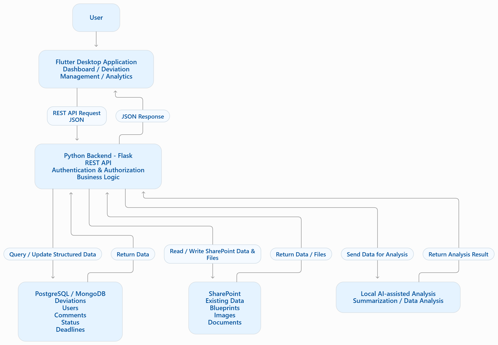

# S4M: Dashboard and Analysis Tools for the Deviation Recording System

**Student Project 20 · Project reference: S4M – deviations app**

A planned standalone Flutter desktop application for managing deviation records,
tracking progress, and analysing recurring issues. The application will support
reading and writing data in SharePoint and provide locally AI-assisted analysis.

## Project status

The project is currently in the requirements and architecture planning stage.
This repository contains dashboard requirements and a proposed architecture
diagram. It does not yet contain a runnable Flutter application, Flask backend,
database implementation, or AI component.

The architecture below is a proposal. Storage ownership, database selection,
authentication, deployment, and the SharePoint integration approach still need
to be agreed and validated.

## Purpose and expected outcome

A deviation is an issue or a difference from what was planned or required.
The system should help users understand what happened, who is responsible,
what action is needed, and when the issue should be resolved.

The expected outcome is a functional data-management and analysis solution that
allows users to:

- View, search, filter, and edit deviation information.
- Assign responsibility and track statuses and deadlines.
- Access related drawings, images, documents, and comments.
- Understand the overall situation through dashboard metrics and charts.
- Use local AI assistance to summarise records and explore recurring patterns.

The project also investigates SharePoint limitations and alternative integration
approaches before deciding whether additional storage is needed.

## Target users

| User | Planned capabilities |
| --- | --- |
| Manager / Supervisor | Review deviations, assign work, monitor statuses and deadlines, inspect attachments, and use analytics. |
| Assigned Worker | View assigned deviations, review details and attachments, add comments, and update status according to permissions. |

## Planned features

### Deviation management

Each deviation should include its type, severity, description, submitter,
assigned user, status, deadline, related drawing or assembly/ship reference,
attachments, and comments.

The planned status workflow is:

```text
Open → In Progress → Closed
```

Users should be able to search and filter records, view their assignments,
review upcoming and overdue deadlines, and perform permitted updates.

### Dashboard and analytics

The dashboard should show total, open, in-progress, closed, and overdue
deviations, together with deviations assigned to the current user.

Planned analysis views include deviations by type, status, severity, assigned
user, and time period. Local AI assistance may provide summaries of recurring
issues and patterns. AI results should be presented for user review and should
not automatically modify deviation records.

## Proposed system architecture



| Component | Proposed responsibility |
| --- | --- |
| Flutter desktop application | Present the dashboard, deviation details, editing screens, attachments, and analysis results. |
| Python Flask REST API | Handle requests, enforce permissions, validate input, apply business rules, and coordinate integrations. |
| Database, if needed | Store agreed structured application data, such as deviation records, assignments, comments, statuses, deadlines, and file references. |
| SharePoint | Provide access to existing records and files, including drawings, images, and documents. |
| Local AI analysis component | Process permitted data locally and return summaries or analysis results through the backend. |

In this design, Flutter communicates with the backend rather than connecting
directly to the database or SharePoint. Structured API requests and responses
use JSON; images and documents may require separate file-transfer handling.

### Storage and deployment decisions

- **Database choice:** PostgreSQL and MongoDB are alternatives to evaluate, not
  two databases that must both be implemented. A separate database may not be
  necessary if SharePoint meets the agreed requirements.
- **Source of truth:** Define which system owns each record or field before
  implementing writes. If SharePoint and a database both hold related data,
  define synchronisation and conflict handling.
- **Files:** Where appropriate, retain files in SharePoint and store their
  references and metadata instead of duplicating file content.
- **Authentication:** Agree on the identity provider, user roles, and access
  rules for the application and SharePoint. Enforce permissions in the backend.
- **Deployment:** Decide whether Flask runs on each user's machine or as a
  shared service, and where the local AI component runs. A standalone desktop
  interface does not automatically provide offline access to SharePoint.

## Data flow

### 1. Load the dashboard

1. Flutter requests dashboard data from the Flask API.
2. The backend checks the user's identity and permissions.
3. The backend retrieves permitted records from the agreed data source and
   prepares dashboard totals.
4. The backend returns JSON, and Flutter displays the list, cards, and charts.

### 2. Update a deviation

1. A user changes a field, such as the status from Open to In Progress.
2. Flutter sends the proposed update to the backend.
3. The backend checks permission, validates the change, and saves it to the
   authoritative store.
4. After a successful save, the backend returns the updated record and Flutter
   refreshes the interface. A failed update should produce a clear error.

### 3. Open an attachment

1. The user selects a related image, drawing, or document.
2. Flutter requests it through the backend.
3. The backend checks access and retrieves the file from SharePoint or the
   agreed file location.
4. Flutter receives the file or an authorised download reference and opens it.

### 4. Request local AI analysis

1. An authorised user requests a summary or analysis.
2. The backend selects the relevant permitted data and sends it to the local
   analysis component.
3. The component processes the data and returns its result to the backend.
4. The backend returns the result to Flutter for the user to review.

## Team responsibilities

| Role | Main responsibilities | Expected outputs |
| --- | --- | --- |
| Architecture & Integration | Define component boundaries, data flows, SharePoint integration, storage ownership, and interfaces between components. | Architecture diagram, integration recommendations, and an integration plan. |
| Database & Data Model | Evaluate storage options and model deviations, users or identity references, assignments, comments, statuses, deadlines, and attachments. | Database comparison and proposed data schema. |
| Backend & Authentication | Define and implement the Flask API, authentication integration, permissions, validation, and business logic. | API specification and backend prototype. |
| Dashboard & Analytics | Design and build the Flutter interface, workflows, dashboard metrics, charts, and analysis views. | Wireframes, dashboard prototype, and analytics proposal. |

Local AI work needs an explicit owner, with coordination across backend,
analytics, and integration responsibilities.

## Relationship to Project 18

Project 18, **S4M: Cost, Time and Material-Waste Impacts of Deviation Types**,
investigates the impacts of different deviations and provides a basis for
calculating and presenting them.

Project 20 can use those findings to implement useful impact metrics and
visualisations. The teams should agree on the required fields, units, and
calculation methods before those measures are implemented.
